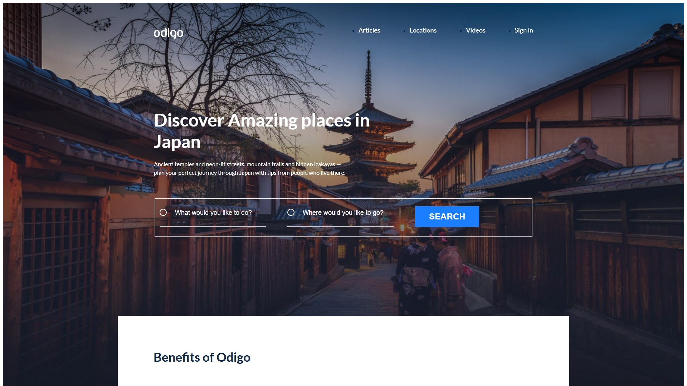

# 🗾 Odigo — тревел-лендинг «Discover Amazing places in Japan»

Адаптивный лендинг путеводителя по Японии, свёрстанный с нуля по макету Figma. Поиск по направлениям, карточки мест, подборки префектур, видео и интерактивная навигация на чистом JavaScript без библиотек.

[>>> Открыть сайт <<<](https://pavelreb.github.io/Travel_Jacobvoyles/)



## ✨ Что внутри

- 🖥️ **Первый экран** с формой поиска «What would you like to do / Where would you like to go»
- 💎 **Benefits of Odigo** — три преимущества сервиса
- 🗻 **Get inspired for your next trip** — плитка мест: Фудзи, Киото, Токио, Ниигата, Саппоро
- 🎋 **Prefecture in Focus** — обзоры префектур Тоттори и Арасияма
- 📍 **Today top places** — шесть карточек городов с лайками и комментариями
- 🎬 **Видео** — встроенный YouTube-плеер
- 🍔 **Бургер-меню**, плавный скролл к якорям, липкая шапка при прокрутке

## 🛠️ Технологии

| Технология | Применение |
|------------|-----------|
| **HTML5** | Семантическая разметка |
| **CSS3 (Flexbox / Grid)** | Плитки мест и раскладка секций |
| **Media Queries** | Адаптив под десктоп, планшет и мобильные |
| **JavaScript (ES6)** | Бургер-меню, плавный скролл с easing-анимацией, липкий хедер — без библиотек |
| **Figma** | Вёрстка по макету |
| **Локальные шрифты** | Lato (woff/woff2), без внешних CDN |

## 🚀 Запуск

Сборка не требуется — достаточно открыть `index.html` в браузере или развернуть на любом статическом хостинге (GitHub Pages, Netlify, Vercel).

## 📁 Структура

```
Travel_Jacobvoyles/
├── index.html      # Разметка страницы
├── css/
│   ├── style.css   # Основные стили + адаптив
│   └── reset.css   # Сброс стилей
├── js/
│   └── main.js     # Меню, скролл, липкий хедер
├── fonts/          # Lato woff/woff2
└── img/            # Изображения, SVG, фавиконки
```

## ⚡ Оптимизация

- Сжатые версии изображений (`*-min.jpg`)
- Локальные шрифты в woff2
- Полный набор favicon для всех платформ

## 📎 Материалы проекта

- Макет Figma: [Перейти](https://www.figma.com/file/ClPSP7KCU1NbvxMXA914hlFk/travel-landing-page-jacobvoyles?node-id=0%3A1)
- Серия видеоуроков, по которой велась вёрстка: [Смотреть](https://www.youtube.com/watch?v=OkNfBnq_c7c&list=PL5_s7xdj2Vsw-bCx5nOZJMFIiHwRgok--)
